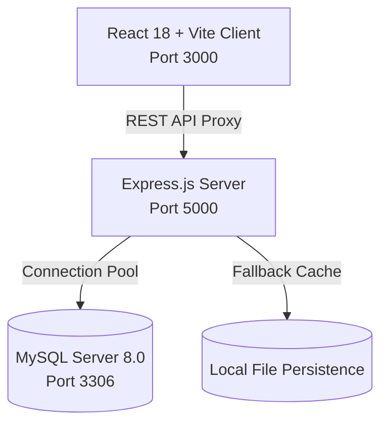

# 🍽️ SVKM College Canteen Management System

A modern, full-stack college cafeteria food ordering and administrative management application designed exclusively for SVKM students, faculty, and cafeteria administrators.


---

## 🌟 Key Features

- **🎓 SVKM Institutional Access**: Secured authentication enforcing verified SVKM email addresses and SAP ID student credentials.
- **🍛 Rich Cafeteria Menu**: Categorized dishes with real-time price updates, high-res photography, and instant Pure Veg & Jain dietary filters.
- **🤖 BiteBot AI Assistant**: Interactive campus chatbot providing recommendations, weekly meal schedules, and pricing queries.
- **🛒 Real-Time Cart & Checkout**: Server-side price validation, pickup slot selection, special cooking notes, and instant simulated UPI / cash payments.
- **📦 Live Order Tracker**: Real-time status progression (`Placed` → `Preparing` → `Ready` → `Completed`) with automated polling.
- **📊 Admin Power Dashboard**:
  - Live revenue analytics and month-end earnings reports.
  - Interactive food management (photo uploads, pricing, availability toggles).
  - Category manager and live order processing terminal.
- **🗄️ Relational MySQL Integration**: Normalized database with foreign keys, indexing, and transactional integrity for order placements.

---

## 🏛️ System Architecture



---

## 🚀 Quick Start Guide

### 1. Prerequisites
- [Node.js](https://nodejs.org/) (v18 or newer)
- [MySQL Server](https://dev.mysql.com/downloads/mysql/) (v8.0) or MySQL Workbench / XAMPP

### 2. Install Dependencies
```bash
# Install root, backend, and frontend dependencies
npm install
npm --prefix server install
npm --prefix client install
```

### 3. Environment Configuration
Copy the sample environment file in `server/`:
```bash
cp server/.env.example server/.env
```
Configure your MySQL credentials in `server/.env`:
```env
PORT=5000
JWT_SECRET=your_secret_jwt_key
DB_HOST=127.0.0.1
DB_PORT=3306
DB_USER=root
DB_PASSWORD=your_mysql_password
DB_NAME=svkm_canteen
```

### 4. Database Setup & Migration
Start your MySQL service on Windows:
```cmd
net start MySQL80
```
Run the automated schema and data migration:
```bash
node server/db/migrate.js
```
*This automatically builds the database schema and imports all 40+ dishes, categories, and administrator credentials.*

### 5. Launch the Application
Start both frontend and backend concurrently:
```bash
npm run dev
```

- **Frontend Application**: [http://localhost:3000](http://localhost:3000)
- **Backend API Server**: [http://localhost:5000](http://localhost:5000)
- **Database Status Endpoint**: [http://localhost:5000/api/db/status](http://localhost:5000/api/db/status)

---

## 🔐 Default Credentials

| Account Role | Login Identifier | Password | Access Level |
| :--- | :--- | :--- | :--- |
| **Administrator** | `kasim@svkm.com` / `53013240051` | `kasim@#!23` | Full Admin Dashboard & Menu Controls |
| **Student (Demo)** | `alex.johnson@svkm.ac.in` | `student123` | Student Cafeteria Ordering Portal |
| **Teaching Staff** | `prof.sharma@svkm.edu.in` | `staff123` | Staff Priority Ordering |

---

## 📂 Project Structure

```text
├── client/                     # React 18 frontend
│   ├── src/
│   │   ├── components/         # Reusable UI cards, progress bars, images
│   │   ├── context/            # AuthContext, CartContext, ToastContext
│   │   ├── pages/              # Menu, Cart, Checkout, OrderTracking, Dashboard
│   │   │   └── admin/          # Admin Dashboard, Foods, Categories, Orders
│   │   ├── App.jsx             # Main routing setup
│   │   └── main.jsx
│   ├── index.html
│   └── vite.config.js
├── server/                     # Express.js REST API
│   ├── data/                   # Fallback data storage
│   ├── db/
│   │   ├── schema.sql          # MySQL relational database definition
│   │   ├── mysql.js            # MySQL2 connection pooling & transactions
│   │   ├── database.js         # Unified database access layer
│   │   └── migrate.js          # Automated database migration runner
│   ├── middleware/             # JWT auth & admin authorization
│   ├── routes/                 # Auth, Foods, Categories, Orders, Admin, Chat
│   ├── uploads/                # Dish image uploads storage
│   ├── .env.example            # Sample configuration template
│   └── index.js                # API server entrypoint
├── .gitignore
├── package.json
└── README.md
```

---

## 📜 License
This project is open-source and developed for the SVKM College Cafeteria Management System.
